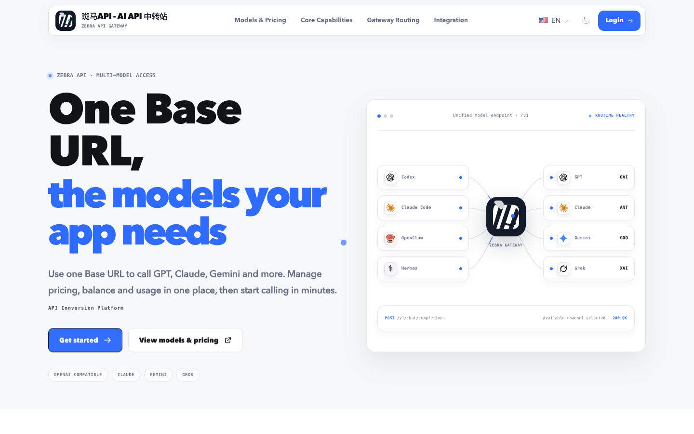
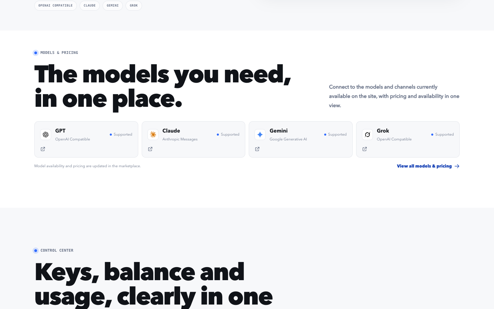
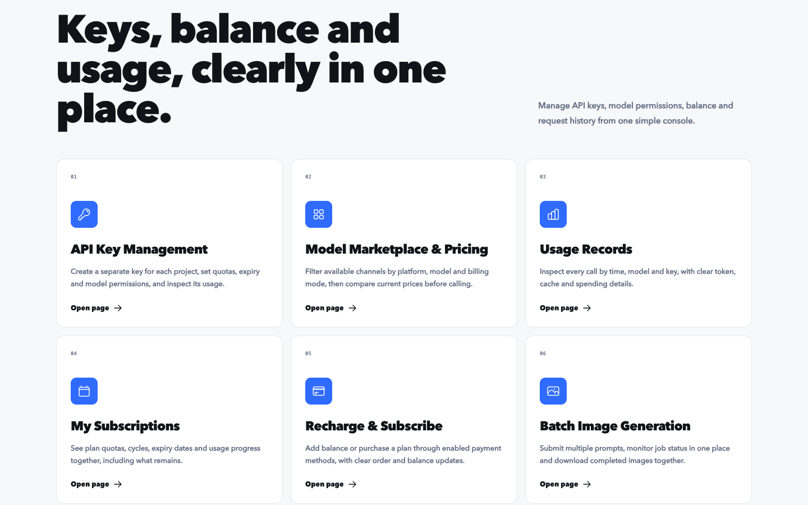

# 斑马 API 价格与充值指南：Codex、Claude Code 用户如何选分组

斑马 API 更适合已经确定要用 Codex 或 Claude Code、现在正在比较价格与接入便利度的人。它把模型选择、项目 Key、余额和调用记录集中到一个后台，核心卖点是**减少多工具切换时的配置与对账成本**。

[打开斑马 API 注册与模型入口](https://bmapi.020212.xyz/register?aff=7BCLX7PTENTW)

## 先决定你用什么工具

Codex、Claude Code 虽然都属于代码代理，但接口协议不同。购买前先锁定主工具：Codex 侧优先看 OpenAI 兼容路线，Claude Code 侧优先看 Anthropic Messages 接口。斑马首页将不同应用和模型族放在同一网关下，适合双工具并行的人。

核价时模型市场共有 **50 个模型**，其中 Claude 17、OpenAI 11、Gemini 9、DeepSeek 5；这四类已经覆盖代码代理最常用的选择。公开计费共分按 Token、按积分和按图片三类，其中按 Token 项 40 个，适合用真实代码任务核算输入、输出和缓存成本。

## 分组不是选择题，按场景直接选

- 只想体验：选择最低成本且规则清楚的组；
- 每天写代码：选择高峰可用性更适合日常工作的组；
- 团队项目：选择能够拆 Key、限制额度、查看逐次账单的方案；
- 高价值任务：优先选择来源和限制说明更完整的组。

不用把所有组研究一遍。拿你最常用的一个仓库任务，对两个候选组分别跑相同工作流，很快就能看出速度、输出和消耗差异。

## 充值步骤

通过入口注册后，进入钱包/充值页面，选择页面显示的金额与支付方式。首充金额按“一个代码工具连续使用几天”准备即可。到账后不要直接使用默认主 Key，而是新建两把：`codex-project` 和 `claude-project`，分别设置额度。

充值完成后进入模型市场，复制精确模型 ID 和分组名；回到工具配置中填写地址、Key、模型。OpenAI 兼容客户端可将 Base URL 设为 `https://bmapi.020212.xyz/v1`，聊天请求走 `/v1/chat/completions`。第一次任务选一个小仓库，完成读文件、修改、工具调用与长输出，再到后台看消费记录。

## 价格比较的正确姿势

同名模型可能存在多组报价。真正要比较的是“完成一次相同代码任务花多少钱”，而不是只看每百万 Token 的最低数字。输出倍率、缓存、重试和工具调用都会改变最终消耗。建议用同一仓库、同一指令、同一完成标准做两次对照。

例如公开报价中，`gpt-5.6-sol` 为输入 **$0.75/M**、输出 **$4.50/M**、缓存读 **$0.075/M**；更低价的 `gpt-6.1-terra` 为输入 **$0.15/M**、输出 **$0.75/M**、缓存读 **$0.0075/M**。日常修改可以先试低成本路线，复杂重构再升级；这比所有任务固定用高价模型更容易控制预算。Gemini 用户还可比较 `gemini-2.5-flash` 的输入 **$0.45/M**、输出 **$3.75/M**。

## 为什么适合作为知名接口的替代选择

常见官方 API 需要分别开户、充值与管理密钥；斑马把多模型收进一个账户。它特别适合预算有限、需要快速切换模型的个人开发者，以及同时维护多个客户项目的小团队。一个模型临时不适合时，可以在同一后台更换路线，不必重新搭建整套配置。

## 最值得使用的功能

项目级 Key 比模型数量更重要。每个项目独立额度、独立到期时间、独立日志，既能控制成本，也便于排查。个人也应按工具拆 Key，而不是把一把无限额密钥放进所有客户端。

## FAQ

### 斑马 API 适合 Codex 吗？
适合希望自定义 API 地址、在多种模型路线间选择的用户。接入后用真实工具调用任务验收。

### Claude Code 怎么配置？
选择 Claude 兼容分组，为它创建独立 Key，按文档填写网关地址与模型 ID。

### 首充后第一件事是什么？
创建限额 Key，并用小仓库跑完整代理任务；不要先跑长时间批量任务。

[注册斑马 API，按工具拆分你的第一组 Key](https://bmapi.020212.xyz/register?aff=7BCLX7PTENTW)
